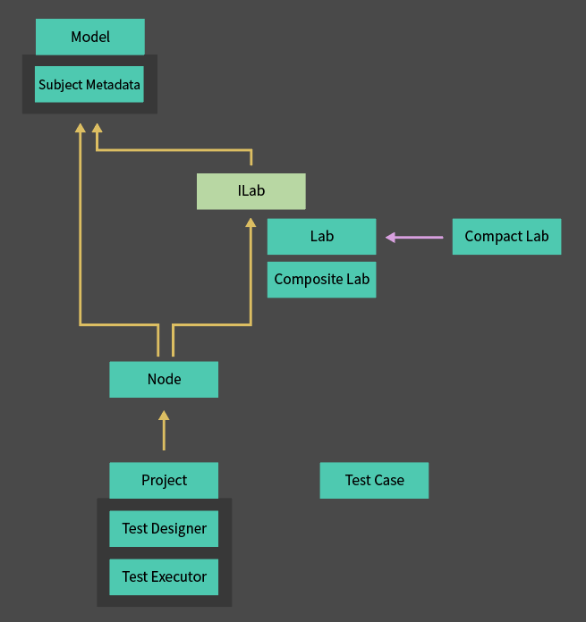

# UniTest Overview

UniTest generates execution paths and verifies expected state from the actions available in each model state.

## Contents

1. Purpose and approach
2. Core structure
3. Representative execution flow
4. Composing independent states
5. Execution choices and results

## 1. Purpose and Approach

For stateful objects, the same action can produce different results depending on earlier operations. UniTest reduces the need to enumerate each path manually and connects state-action tables to executable verification.

| Aspect | Description |
| --- | --- |
| Overview | Generate available actions from model state and explore paths. |
| Purpose | Systematically broaden verification of state transitions and sequences. |
| Implementation | Separate state, actions, history, and execution control through Model, Lab, Node, and Project. |

The test author defines valid states, actions, and expected results. The framework explores paths permitted by those definitions and execution conditions such as depth limits and failure stopping. It does not automatically verify actions absent from the model or an infinite set of paths.

## 2. Core Structure

- `Model`: holds the actual subject, expected state, and execution history.
- `Lab`: defines an action through Arrange, Act, and Assert. `CompactLab` converts a compact definition into a Lab.
- `Node`: holds the model, action, and result for a particular path. Parent and child relationships form execution paths.
- `Project`: generates available Labs and coordinates node design and execution.

Keeping actual and expected state separate avoids treating an incorrect result as its own oracle. See [Testing Methodology](00-Unit-Test-Guideline.md) for state-action table design.

## 3. Representative Execution Flow

1. The project creates a root node with an initial model.
2. It generates the Labs available in the current model.
3. Each action receives a model with the preceding path replayed.
4. The test prepares expected state, performs the action, and compares the results.
5. Continuable nodes generate subsequent actions.
6. Execution finishes according to depth, failure, or cancellation conditions and returns results.

The model and scenario own the subject's lifecycle and side effects. The framework does not automatically clone or roll back arbitrary external systems.

## 4. Composing Independent States

An object with rider, battery, and charging states can use per-axis rules instead of one large state table.

- `TestCase`: expresses the actions and conditions allowed in the current combination.
- `Merge`: combines state-specific rules with an action template in one Lab.
- `Extend`: combines preparation and verification layers while the original Lab performs the action.

Each axis prepares and verifies the state it owns. See the multi-state tutorial in [Usage](04-Usage.md) for composition order and concrete examples.

## 5. Execution Choices and Results

Full path exploration examines state combinations broadly. Continuous execution selects a sustainable path to inspect a long history. Replaying stored Lab ID paths focuses execution on a particular failure.

Execution returns a node tree. JSON reports store independent values from that result, and failure reports include failed nodes and the ancestors needed to explain their paths. See [Implementation](02-Implementations.md) for execution modes, cancellation, and failure responsibilities, and [Usage](04-Usage.md) for calling examples.
